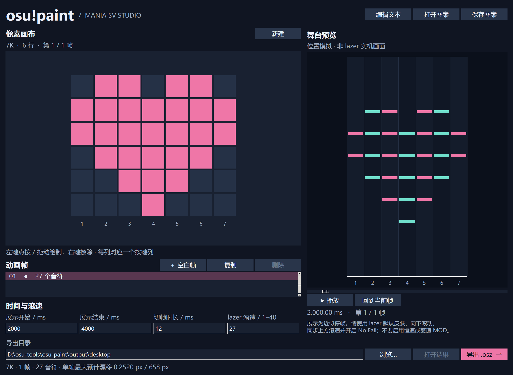

# osu-paint

把 osu!mania 的音符当作像素，用来画画、做动画。

将手绘、`#` / `.` 文本或本地视频变成 osu!lazer / stable mania 的像素图案与动画。支持 1–18 列、逐帧时间、独立音频和连续亮格合并长条，导出 `.osz` 谱面及匹配画布的 Pixel Film 皮肤。展示阶段近似静止，通过快速滚动切帧。

**[最新版本与全部下载](https://github.com/YeLn10/osu-paint/releases/latest)** · [使用指南](docs/usage.md) · [反馈问题](https://github.com/YeLn10/osu-paint/issues/new/choose) · [更新日志](CHANGELOG.md)

| v0.1.1 下载 | 运行要求 |
| --- | --- |
| [Windows x64 ZIP](https://github.com/YeLn10/osu-paint/releases/download/v0.1.1/osu-paint-v0.1.1-windows-x64.zip) | Windows 10/11，解压运行 `osu-paint.exe`，无需安装 Python。 |
| [Linux x64 试用包](https://github.com/YeLn10/osu-paint/releases/download/v0.1.1/osu-paint-v0.1.1-linux-x64.tar.gz) | Ubuntu 22.04+ / glibc 2.35+ 桌面环境，无需安装 Python；[解包与运行](docs/building.md#linux-x64)。 |

两个下载均无需登录 GitHub。独立皮肤、源码和 SHA-256 校验文件见版本页面；实际作品优先使用应用导出时生成的皮肤。

## 快速开始

1. 按系统下载上表的应用包；Windows 解压后运行 `osu-paint.exe`。绿色 **Code → Download ZIP** 下载的是源码。
2. 选择目标客户端，绘图、打开示例或导入视频；按需导入音频并调整倍速、截取起点和开始时间。
3. 设置展示时间及与游戏一致的滚速，预览后保存 JSON 项目并导出 `.osz`。
4. 将 `.osz` 和本次导出目录中匹配窗口比例的 `.osk` 分别导入游戏，选择该皮肤，使用向下滚动、相同滚速和 No Fail。

`examples/heart.txt`、`examples/pulse.txt` 和 `examples/free.json` 可用于试用。完整操作、视频参数、命令行示例与常见问题见 [使用指南](docs/usage.md)。工具无需 osu! 插件，不修改游戏或系统配置。

## 使用边界

- 预览模拟连续位置；有限切帧和未知显示相位仍可能产生残影，不能保证实机零闪影。
- 目标 lazer `2026.921.0` 的 >10K 强制双舞台，11/13/15/17K 少一列，皮肤无法解除。stable 支持合并 1–18K，但低键数可能无法铺满横向。
- 皮肤必须匹配客户端、窗口比例和画布行数。独立皮肤包默认 24 行，实际作品优先使用本次导出的版本。
- 观看使用 No Fail。Autoplay 曾收到强烈频闪反馈；lazer“音乐继续、画面定格”仍无经过实机确认的完整解决方案，见 [使用指南](docs/usage.md#常见问题)。

## 文档导航

| 内容 | 入口 |
| --- | --- |
| 绘制、音视频、时间、命令行与导出 | [使用指南](docs/usage.md) |
| 皮肤选择、客户端限制与资源依据 | [皮肤说明](docs/skin.md) |
| 环境、测试与 EXE 构建 | [构建指南](docs/building.md) |
| 目录、模块、项目格式与线程约束 | [架构](docs/architecture.md) |
| 积分、清场与刷新率排帧算法 | [时间模型](docs/timing.md) |
| 历史实验、版本证据与未解决问题 | [研究索引](docs/research/README.md) |
| 版本发布与产物 | [发布指南](docs/releasing.md) · [更新日志](CHANGELOG.md) |
| 中文介绍与演示建议 | [宣传文案](docs/promotion.md) |

osu-paint 是独立工具，非 osu! 官方项目。项目代码与生成的皮肤采用 [MIT](LICENSE) 授权；桌面包中的音视频组件保留各自许可证，见 [第三方说明](THIRD_PARTY_NOTICES.md)。
