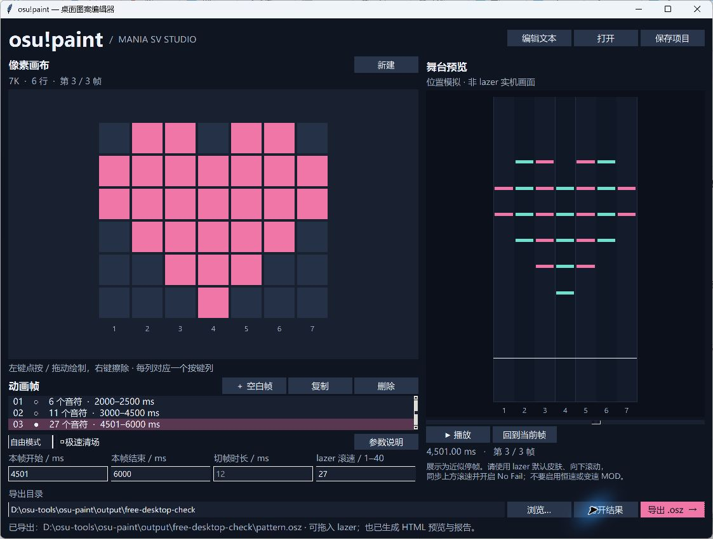

# osu-paint

把 `#` / `.` 文本像素图变成 osu!mania lazer 音符图案或多帧动画。在指定毫秒区间展示，通过快速滚动进场、切帧和退场。展示阶段是**近似停止**，不是精确零速。

## 桌面端（Windows）

直接双击 **`dist/osu-paint.exe`** 即可打开独立桌面窗口，无需安装 Python，也不会弹出命令行窗口。可以将这个 EXE 单独复制到其他目录使用；它不依赖旁边的示例文件或源码。



- **像素画布**：默认载入心形；左键点按或拖动绘制，右键擦除。“新建”可以选择 1–10 列和图案行数。
- **动画帧**：新增空白帧、复制、删除和切换帧。所有帧保持同一尺寸；每帧至少绘制一个音符才能预览、保存或导出。
- **项目与文本图案**：打开 `.json` 项目或 `.txt` 图案，也可用“编辑文本”粘贴 `#` / `.` 多帧图案。“保存项目”默认保存 JSON，包含每帧时间、模式与滚速；另存 TXT 仅保存图案。
- **自由模式**：时间区域选择“自由模式”，选中动画帧后设置“本帧开始 / 本帧结束”。支持不等时长和帧间空档；重叠、倒序或切换间隔不足会提示错误。切回“均分模式”会恢复原来的总时间设置，再切回自由模式仍保留逐帧时间。
- **参数与预览**：默认开启“极速清场”，自动计算最快合法切帧时长；关闭后可以手动填写。支持播放、暂停、拖动时间轴和回到当前帧。预览包含判定线下方区域，不会在判定时间直接隐藏音符。
- **导出**：选择目录，点击“导出 .osz”。默认目录为用户主目录下的 `osu-paint-output`；完成后可点“打开结果”。同名生成文件覆盖前会确认，不会删除其他文件。导出过程中可以继续编辑，导出内容是点击按钮时的快照。
- **修改保护**：新建、打开其他图案或关闭窗口时，未保存的图案或参数会提示确认。

预览只模拟音符位置，不是 lazer 游戏画面，也不播放音频。生成器和 CLI 使用同一套逻辑，具体限制及游戏设置见下文。

### 自由模式与参数含义

可打开 `examples/free.json` 体验三帧时间表：2000–2500 ms、3000–4500 ms、4501–6000 ms。首帧在 2500 ms 开始退场，第二帧在 3000 ms 完整到位；中间留出空档。第三帧与第二帧间隔很短，会共用一次推进。

“开始 / 结束”指**完整图案的展示区间**，进场在开始之前，退场从结束时刻开始。不能将有限速度的滚动设成零时间瞬移。每帧需要结束 > 开始，按列表顺序排列，相邻两帧的间隔至少为实际切帧时长；间隔超过两倍时长时，分别退场和进场，中间保持空场。新增或复制帧会放在当前帧之后，不会自动挪动其他帧的时间。

| 参数 | 实际影响 |
| --- | --- |
| 切帧时长 | 一次快速推进约 1.1 个判定线上方区域高度所花的时间；越短越快，越长越容易看见下落。均分模式先从总时间扣除切帧时间；自由模式保持填写的展示时间，检查间隔是否足够。 |
| 极速清场 | 覆盖手动切帧值，自动接近合法速度上限。滚速 27 时约 0.575 ms，滚速 40 时约 0.388 ms，滚速 1 时约 15.510 ms。界面底部和报告显示实际值。自由模式间隔在一到两倍时长之间时，共用一次推进，其持续时间等于该间隔。 |
| lazer 滚速 | 必须与游戏内相同，决定滚动时间如何换算为舞台上的位置和速度。不是动画 FPS，也不是 BPM；调大不会改变自由模式填写的展示时间。生成器会重新计算音符位置与变速点，只改游戏内滚速而不重新生成会使图案变形或错位。 |

旧版默认 12 ms 的退场仍会被显示器采到。极速清场改的是实际导出的红线、绿线和音符时间；在默认滚速 27 的位置模型中，旧图案在结束后 1 ms 内已越过整个舞台及判定线下方区域。新预览不会通过提前隐藏音符制造“已清场”的假象，但不模拟游戏的皮肤、判定与 Miss 淡出。有限速度仍可能被某一次刷新采到，不能承诺绝对零残影；自定义皮肤或不同客户端版本仍需实测。

点击界面的“参数说明”也能查看这些规则。JSON 项目保存全部编辑参数；`report.json` 是导出检查报告，不是可打开的项目文件。

### 从源码启动 / 重新打包

源码运行需要 Python 3.10+ 和 Tkinter，不需要第三方运行依赖。可以双击 `osu-paint.pyw`（需要系统已关联 Python），或执行：

```powershell
python osu_paint_desktop.py
```

重新生成 Windows EXE：

```powershell
powershell -NoProfile -ExecutionPolicy Bypass -File .\build_desktop.ps1
```

脚本会在项目的 `.build-env` 中安装 PyInstaller 6.22.3，仅用于打包；不修改全局 Python 环境。首次构建需要联网下载打包工具，产物为 `dist/osu-paint.exe`，中间文件在 `build/`。EXE 未做代码签名，Windows 可能显示未知发布者提示。

## 命令行（继续保留）

需要 Python 3.10+，不安装第三方依赖。在本目录执行：

```powershell
python osu_paint.py examples/heart.txt --start-ms 2000 --end-ms 4000 --output output/heart
```

CLI 保留原来的 12 ms 默认值；加上 `--fast-clear` 使用与桌面端默认相同的极速清场。下方 12 ms 时间表示例均对应未开启极速清场的情况。

输出：

- `output/heart/pattern.osz`：包含谱面和静音音频，可拖入 lazer 导入。
- `output/heart/preview.html`：用浏览器打开，播放或拖动滑块检查图案位置。
- `output/heart/pattern.osu`：可查看 TimingPoints 和 HitObjects。
- `output/heart/report.json`：时间点、音符位置、参考 BPM、预测漂移。

运行相同命令会覆盖输出目录内这五个同名生成文件。

## 输入和时间含义

每行等宽，支持 1–10 列，每列对应一个按键列；从上往下书写图案，`#` 表示普通音符，`.` 表示空位。例如：

```text
.##.##.
#######
#######
.#####.
..###..
...#...
```

程序将行中心均匀放在可滚动区域的 20%–80% 之间。它画的是音符排列，音符大小、颜色和长宽比仍由游戏皮肤决定，不保证成为正方形像素。

`--start-ms 2000 --end-ms 4000` 表示：

| 时间 | 行为 |
| --- | --- |
| 1988–2000 ms | 快速进场 |
| 2000–4000 ms | 完整展示，极低速漂移 |
| 4000–4012 ms | 快速退场 |

使用 `--transition-ms` 修改进场、退场各自的时间，默认 12 ms。进场前必须留出至少 100 ms 的正常 BPM 段；程序会检查参考 BPM 是否仍为 120。不合法的时长或改变参考 BPM 的组合会报错。

音符的**判定时间位于退场段**。这不是错误：要使音符留在判定线上方，必须根据滚动距离反解未来的判定时间，不能将展示起点直接当成音符时间。

## 多帧动画

把多个同尺寸图案写入一个文本文件，以独立的 `---` 行分隔。每帧至少包含一个 `#`。例如：

```text
#..
.#.
..#
---
..#
.#.
#..
```

已有三帧心形放大示例：

```powershell
python osu_paint.py examples/pulse.txt --start-ms 2000 --end-ms 5000 --output output/pulse
```

所有帧平分给定时间范围，先扣除帧间的换帧时间；外侧进场、退场仍在时间范围之外。上例中：

| 时间 | 行为 |
| --- | --- |
| 1988–2000 ms | 第一帧进场 |
| 2000–2992 ms | 第一帧展示 |
| 2992–3004 ms | 第一帧退场，同时第二帧进场 |
| 3004–3996 ms | 第二帧展示 |
| 3996–4008 ms | 第二次切帧 |
| 4008–5000 ms | 第三帧展示 |
| 5000–5012 ms | 最后一帧退场 |

`report.json` 的 `frames` 列出每帧的实际展示时间和漂移；顶层漂移值表示各帧中的最大值。预览随播放切换当前文本图案与帧号。三帧示例的单帧最大理论漂移约 0.125 像素。

慢速红线的 beatLength 在整段动画中保持互异。相同快速红线的累计时长也会影响参考 BPM；如果帧数太多导致参考 BPM 改变，程序会报错，需要增加 `--start-ms` 留出更长的开场，或缩短合法范围内的换帧时间。时间范围必须严格大于所有帧间切换时间之和。

## 在 lazer 中查看

1. 导入 `pattern.osz`，选择生成的 `SV Pattern` 难度。
2. 使用 lazer 默认皮肤、向下滚动，将 mania 滚速设为 **27**。也可以生成时指定 `--scroll-speed`，并同步游戏设置。
3. 开启 No Fail；不要启用恒速滚动、改变列数、随机排列、镜像或速度类 MOD。播放时不要跳过开头。

坐标模型按默认 lazer 舞台计算：内部高度 768、判定线下方高度 110，可滚动高度 658；考虑了源码中的皮肤滚速校正 `TimeRange = 11485 / ScrollSpeed × 658 / 643.2`。其他皮肤、舞台布局或 MOD 需要重新校准；普通音符的图形也可能与预览不同。

两秒示例的理论漂移约 **0.252 像素 / 658 像素高度**。预览只是位置模型，不模拟游戏的皮肤、判定、淡入淡出和物件生命周期。12 ms 的快段也可能被显示器采到，不能保证完全无过渡帧。

## 原理和验证

当前 lazer 的绿线 SV 被限制在 0.01–10，红线 beatLength 在 6–60000 ms。程序组合红线和绿线，并积分实际倍率来布置音符。慢段每 50 ms 切换到不同的合法 beatLength，避免长慢段变成参考 BPM。每条红线后都补同时间绿线。详细证据见 [调查报告](docs/research/mania-sv-animation.md)。

```powershell
python -m unittest discover -s tests -v
```

桌面交互测试使用真实 Tk 控件，需要可用的图形桌面环境；覆盖绘制/擦除、多帧、自由模式逐帧时间、JSON 保存恢复、文本读写与编辑窗口按钮布局、参数验证、播放进度、覆盖确认、后台导出及关闭保护。导出级测试包含自由时间表、空档、合法速度边界、120 帧切换及完整舞台清场。

测试重新解析导出的 `.osu`，独立积分并包含 lazer 的分段 float32 舍入，检查图案方向、列号、起点坐标、展示漂移、进出场、速度上下界、参考 BPM、输入错误和 `.osz` 内容。多帧测试还检查相邻帧串入、120 帧时的参考 BPM；安装了 Node.js 时，会额外检查单帧和多帧预览的 JavaScript 语法。

**目前完成源码核查与自动化数据验证，尚未在 osu!lazer 客户端中实测导入与显示。** 程序生成新的静音测试谱面，支持单幅图案及等时长文本多帧；不修改已有谱面，不包含图片或视频解码、长条填充。
