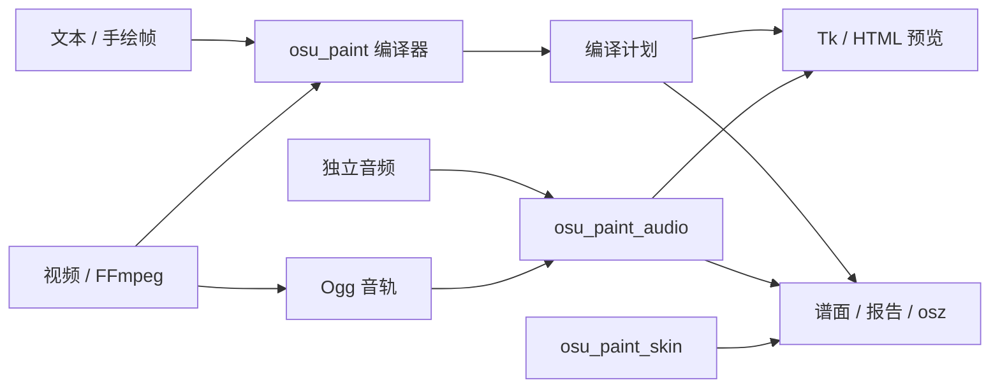

# 架构与维护

本文描述当前模块、数据流和项目格式。修改时间、位置、SV 或排帧前还须阅读 [时间模型](timing.md)；修改皮肤读取 [皮肤说明](skin.md)。历史实验见 [研究索引](research/README.md)，日常流程见 [AGENTS.md](../AGENTS.md)。

## 目录与模块

```text
osu_paint.py             编译器、位置模型、导出与 CLI
osu_paint_desktop.py     Tk 编辑器与项目管理
osu_paint_video.py       视频转换与刷新率排帧
osu_paint_audio.py       音轨编辑与播放
osu_paint_skin.py        皮肤构建
osu-paint.pyw            无终端窗口的桌面入口
build_desktop.ps1        Windows EXE 构建入口
pixel-film*.osk          两客户端各五套交付皮肤（24 行）
tools/                  皮肤重建、包内核验、发布打包
tests/                  回归与合成客户端夹具
examples/               文本与 JSON 示例
docs/                   使用、设计、构建和发布文档
  research/             按问题索引的历史证据
  releases/             各版本发布说明
licenses/               第三方原始许可证
```

五个模块保留在根目录，共用同一编译器与导出路径；桌面入口和现有导入方式保持直接可用。

| 模块 | 职责与依赖 |
| --- | --- |
| `osu_paint.py` | 解析文本、编译帧、积分位置、编码 `.osu`、写出文件与 CLI。谱面及位置模型的唯一实现，只依赖标准库；CLI 视频分支按需导入视频模块。 |
| `osu_paint_video.py` | 参数解析、可取消 FFmpeg 执行、视频抽帧、提取 Ogg、安排刷新窗口；调用核心编译器，以 `imageio-ffmpeg` 定位 FFmpeg。 |
| `osu_paint_audio.py` | 音频导入、倍速/截取/偏移、播放与定位；复用视频模块的 FFmpeg 执行器，按需加载 pygame / mutagen，不参与谱面编译。 |
| `osu_paint_desktop.py` | Tk 编辑、JSON 保存与恢复、连续位置预览、异步导入和导出；主线程管理控件与项目状态。 |
| `osu_paint_skin.py` | 生成配置、PNG 和 `.osk`；仅依赖标准库，由导出与 `tools/build_skin.py` 共用。 |



HTML 只使用计划中的位置，无声；音轨同步播放由桌面端负责。

## 编译与导出接口

1. `parse_frames` 将 `#` / `.` 文本解析为同尺寸字符串行数组，`---` 分帧。核心默认与 CLI 文本保持严格校验；桌面解析使用 `allow_empty=True`，编译使用 `allow_empty_frames=True`，视频也允许空白帧。整段无音符时只可保存草稿，不能导出有效谱面。
2. `compile_frames` 验证画布、时间窗口、滚速和长条开关，再分派到私有客户端实现。`target_client` 默认 lazer，未知目标报错；公共编辑、媒体与文件写入不复制客户端算法。
3. 编译结果包含窗口、`Point(time, beat_length, sv)`、音符与参考参数，是导出和预览的共同输入。数值规则与实际清场字段见时间模型。
4. `encode_osu` 将列中心映射到 `.osu` 的 0–512 横坐标。短音符 type 1、长条 type 128，每条红线后立即写同时间绿线，避免继承速度被重置。
5. `write_output` 写谱面、音频、报告、HTML 和所选客户端的五套皮肤，皮肤行高匹配实际画布。`.osz` 仅含 mania 谱面和音频，皮肤单独导入；有刷新对齐元数据时另写播放说明。

## 项目格式与兼容

| JSON 版本 | 保存内容 |
| --- | --- |
| v1 | 画布、逐帧时间、时间模式与设置。 |
| v2 | 增加视频元数据和 Base64 Ogg，脱离原视频仍可编辑与导出。未调整的视频项目继续保存 v2。 |
| v3 | 独立或已调整的音轨：`audio` 保存最终 Ogg，`audio_track` 保存文件名、倍速、谱面起点、原轨截取起点、最终时长和 Base64 原始 Ogg。 |

共同兼容约束：

- 顶层 `target_client` 按原目标恢复；未标记时默认 lazer，未知目标在替换当前项目之前报错。
- 已有项目恢复 `merge_holds`，缺少字段时使用 false。新建与新导入默认开启，打开或取消窗口不改变当前项目。
- 旧 `game_fps` / `frame_fps` / `refresh_phase_ms` 忽略，不恢复游戏 FPS 控件或手动相位输入。
- TXT 只保存图案；`report.json` 是编译报告，不能打开为项目。项目保存原媒体文件名，排除绝对路径。

`audio_track.leading_ms` 记录旧视频音轨已补的前导静音。编辑时先扣除它，再按原轨执行 `atrim`、保留音高的 `atempo` 和按样本计算的延迟，避免重复偏移或对上次变速结果再次变速。成功后才替换最终音轨。音频编辑不改变帧时间或刷新对齐，画面排帧也不移动音轨。

## 编辑状态、线程与副作用

视频对话框维护独立目标，点击预览/导入时冻结参数，成功后才替换项目。手动编辑过的高度不随客户端切换重设；视频项目只显示目标，手绘项目可切换。切换目标保留画面、时间、滚速和音轨，撤销失效对齐信息，不自动改行数或重排。

均分极速模式显示只读自动清场结果，手动模式编辑保存的时长；自由模式始终自动清场，保持原手动值供切回均分时使用。核心的显式手动自由时间接口及 CLI 语义保持兼容。

Tk 控件只在主线程操作。导入及选帧预览在后台运行，通过取消事件终止 FFmpeg、队列交回结果，成功后由主线程应用；失败或取消保留项目。导出点击时重新编译并抓取计划与音轨，后台写文件，后续编辑不改变正在导出的快照。

音乐预览跟随音频时钟，音轨结束后画面继续。更改滚速、帧时间、时间模式或画布尺寸后移除失效的刷新对齐信息。参数解析与编译尽量保持纯函数；写文件集中于导出、项目保存和独立皮肤构建，媒体子进程集中于视频模块。

## 验证与文件管理

`tests/` 使用合成输入，覆盖编译、序列化 `.osu` 的独立积分、Node HTML 绘制、真实 Tk 交互与快照、FFmpeg 解码、Ogg 播放及皮肤资源。测试入口与构建流程统一见 [构建指南](building.md)。

Tk / HTML 预览使用默认 16:10 连续几何和客户端舞台宽度，越过判定线的音符仍按几何裁剪；不模拟判定、Miss 淡出、双舞台、整数裁剪或 GPU 显示。客户端渲染结论须有对应实机证据，模型验证不能替代它。

Git 管理源码、测试、文档、示例、许可证和十个可复现的交付皮肤。`.build-env/` 存构建环境，`build/`、`__pycache__/` 存缓存，`dist/` 存 EXE 和发布包，`output/` 与根目录 `.osz` 存本地导出；忽略规则见 `.gitignore`。

清理前核对绝对路径在项目内并确认用途。缓存可清理；个人 JSON、音轨和导出只能按确认范围处理，不因目录名被当作冗余。研究记录中的 `build/`、`output/` 是当次诊断位置，可能已被清理；证据结论及版本依据保留在文档和合成回归中。
