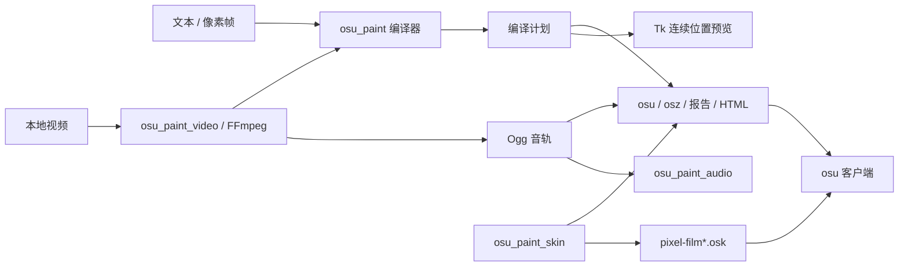

# osu-paint 架构

## 用途与范围

将 `#` / `.` 像素帧或本地视频编译为 osu!lazer / stable mania 音符与 BPM/SV 控制点，在指定时间窗口近似静止展示，再快速进出场。应用可写 1–18 列，桌面端与 CLI 共用生成逻辑。配套皮肤包含 1–18K 配置，默认比例为 3072×1920 对应的 16:10；目标原版 lazer 的 >10K 转换限制见 [皮肤说明](skin.md)。

## 模块与依赖

| 模块 | 职责 | 边界 |
| --- | --- | --- |
| `osu_paint.py` | 解析文本、编译帧、积分位置、编码 `.osu`、导出与 CLI | 核心只用标准库；CLI 视频分支按需导入视频模块 |
| `osu_paint_video.py` | 参数解析、FFmpeg 抽帧与提取 Ogg、刷新窗口安排 | 调用核心编译器；使用 `imageio-ffmpeg` 定位 FFmpeg |
| `osu_paint_audio.py` | 音频导入、倍速/截取/偏移处理、播放与定位 | 按需加载 pygame / mutagen，复用视频模块的可取消 FFmpeg 执行器；不参与谱面编译 |
| `osu_paint_desktop.py` | Tk 编辑、项目保存与打开、预览、异步导入与导出 | 调用以上模块；主线程管理控件与项目状态 |
| `osu-paint.pyw` | 无终端窗口的桌面入口 | 仅启动桌面端 |
| `osu_paint_skin.py` | 生成各比例的皮肤配置、PNG 与 `.osk` | 只用标准库；由导出与构建脚本共用 |
| `tools/build_skin.py` | 重建根目录交付皮肤，可指定行数 | 调用皮肤模块；默认 24 行 |

## 数据流与时间模型

1. `parse_frames` 产生同尺寸的字符串行数组；`---` 分帧。桌面编辑、文本导入与视频均允许空白帧，但整段必须有音符才能生成谱面；全空白草稿仍可保存。核心解析器的缺省严格校验与 CLI 行为保留，桌面统一传入 `allow_empty_frames=True`。
2. `compile_frames` 验证均分 / 自由时间窗口、滚速与长条开关，生成帧窗口、`Point(time, beat_length, sv)` 和音符数组。`target_client` 默认 lazer，显式 stable 使用独立时间策略；未知目标报错。
3. 以下几何和时间范围首先描述 lazer（stable 差异见专节）。`Timeline` 对分段速度积分，并反求给定位置对应的时间。legacy 音符按底边锚定，H 行底边为 `(row + 1) / H`，贴图向上延伸 `1 / H`。先扣除整幅复用画面的累计漂移，再扣约 `1 / 768` 的底部余量，让展示结束时头部时间仍在未来；顶部按屏幕裁剪，避免半格偏移。判定位置为 480，时间范围为 `11485 / scrollSpeed × 480 / 402`，漂移按 768 内部像素高度报告。全高画面清场推进 `1 + 2 / 768` 个舞台高度，覆盖底边 1 像素偏移并留 1 像素舍入余量，避免旧 1.1 屏距离形成大块白带；极速时间与推进速度共享这个距离常量。返回计划是导出与预览的共同输入。
4. `encode_osu` 用列中心映射 `.osu` 的 0–512 横坐标。短音符为 type 1，长条为 type 128；红线后立即写对应绿线，防止红线重置继承速度。
5. `write_output` 写 mania 谱面、音频、报告、预览和五种屏幕比例的 `.osk`，音符高度为 `480 / H`，lazer 列宽为 `480 × 屏幕比例 / 列数`，stable 再钳制到 100。只生成所选目标的五套皮肤。`.osz` 只包含 mania 谱面和音频；皮肤需单独导入。刷新率排帧项目另写播放说明。

lazer 使用小数时间与自身参考 BPM / 滚速模型。滚速仍是用户参数，与游戏设置一致；行数只决定音符高度，不决定游戏的时间到位置换算。长条从连续亮格的底部行起头、顶部行结束，不跨空格或不同画面。相邻相同画面可在漂移预算内共用音符。极速模式会比较原复用组与最多两个重分组候选：4900 ms 参考预算，以及原参考的两倍（不超过 4900 ms）；候选必须比原计划减少至少 20% 的内部总切帧窗口，组数和音符数各自最多增加 10%；从符合条件的候选中选内部过渡最短的，所有负载限制始终以原计划为基准。在已选方案之上，再按时间均衡每段连续相同画面的复用组：组数不变，选择最接近等时间分点的合法帧边界，不跨内容变化或主动空档；仅当内部总过渡再缩短至少 20% 时采用。重新计算参考 beatLength、锚点、音符及漂移，不增加音符或修改原帧窗口，也不增加一次核心编译。首尾进退场不计入收益，纯静态序列不会为缩短首尾而反复重绘。极速清场根据整幅复用画面（含延长展示至实际切帧前的部分）的漂移预算选择参考 beatLength，范围为 500–4900 ms；预算不足时保留原 500 ms，不强行提速。完全无亮格的帧没有音符可漂移，不参与参考 beatLength 的漂移限速；其可见漂移字段为 0，但时间窗口、空白时长和控制点保留。非极速模式仍使用 500 ms；相邻帧共用推进时，实际时长使用手动 `transition_ms`，剩余空档延长静置，不把手动值拉伸为整个间隔。间隔大于两倍预算仍保留独立退场、进场和中间空场。`transition_ms` 保留均分、视频排帧和空档分组预算，`sweep_ms` 为最大实际进出场时长（复用组只计首次进场，不计其累计展示时长）；相邻画面的实际过渡由 `sweep_start_ms` 到下一帧 `start_ms` 表示。压缩只延长上一画面的静置部分，不改写保存的起止时间或音轨。桌面与 HTML 积分必须使用计划中的 `base_beat_length_ms`，不能写死 500。

lazer 极速清场按实际亮格范围缩短行程：旧画面最上亮行 t、新画面最下亮行 b、行数 H，令 S = 1 + 2 / 768，共用行程取 `max(S - t/H, S - (H-1-b)/H)`；空画面不约束相应一侧，两侧都为空则保留整屏行程。独立退场只看旧顶部，独立进场只看新底部。时长按行程与 S 的比值压缩，红线/绿线速度上限和安全余量不变；相邻帧即使预留了一至两倍预算的间隔，也按同一极速速度完成推进，不再随间隔增宽降低 SV。复用候选的总过渡收益按同一实际时长计算。非极速不启用此压缩，stable 继续使用独立整数端点策略。序列化回归验证进入前不可见、退出后无残留以及长条头尾位置；不等同于客户端绘制或显示相位保证。

两端极速模式在建立 `Timeline` 和生成音符之前共用 `_compact_slow_points`：只合并连续、SV 为 0.01 且 beatLength 大于参考值的慢控制点；合并后的跨度须不超过首段参考 BPM 前导时长的一半。保留参考锚点和所有进退场/空档边界；保留的慢红线仍互异，避免长慢段变成参考 BPM。重新积分后再计算头尾位置和漂移，不沿用合并前的音符几何。原参考预算与复用分组保持保守估计，非极速不合并；最终仍按两端各自规则验证参考 BPM。此优化减少谱面控制点，不承诺客户端实测帧率或修复时钟定格。

视频按时间戳采样而非编码帧编号，支持可变帧率。自动排帧按实际频率与向上取整的分频数直接推导各边界，不提高请求 FPS；保留 lazer 按采样序号推进的三角形排帧作基线；再根据核心编译出的实际重绘组（包括静态内容因漂移预算而重绘）生成候选，每 64 次重绘走完可用区间后折返。stable 先由核心给出实际整数清场时长，在前一次名义刷新之后到本次刷新之前的剩余空间内平滑移动，再向下取整。保留原来的保守候选后，两端最多再编译一个紧缩候选：lazer 按核心实际 `sweep_ms` 而非排帧预算计算保护边距；stable 将连续偏移一次取整后钳制到安全整数范围，不再统一多扣 1 ms。紧缩候选重新编译后，必须逐切帧确认实际推进仍在前一次名义刷新之后开始。两端只有候选优于当前已选方案的最坏固定相位命中数、不增加音符数或内部总过渡时长时才采用。在已选方案后最多再编译一次快速折返候选：优先 9/64；排帧约束不通过或时间未变化时，依次尝试 7/64、5/64、3/64，只编译第一个通过检查且时间有变化的候选。编译后无收益或越界即保留原方案，不继续搜索。lazer 使用实际余量，stable 沿用已选余量策略；最长连续命中须严格减少，最坏总命中、音符数与总过渡时长不增加，相邻帧开始间隔相对名义周期的偏差不超过 1 ms。新候选均重新检查实际推进边界。评分使用有理刷新周期的端点扫描和命中位图，避免浮点取模制造伪重叠；上述候选连同基线最多四次编译；stable 的长清场补充候选见下段。候选无足够展示时间、整数余量或无收益时保留原排帧；不更改核心 SV 上限及端点算法。各次微调小于一个刷新周期，不累计舍入，保留请求行数。画面与 Ogg 共用开始时间，保持源音画延迟；播放器无需相位输入。请求参数、实际参数与对齐元数据仍保存于项目和报告，界面不展示内部转换说明。

stable 在清场大于半个刷新周期但小于一个周期、且内容周期扣除两个刷新周期后仍能容纳原排帧预算和 1 ms 展示时，最多额外编译两个长清场候选。先保留按实际重绘组在接近一个完整刷新周期内折返的旧候选，仅在旧宽候选已获采纳后，再尝试按整数帧间隔的可用速度折返：每次真正重绘时向可用范围的一端推进，下一开始时刻限定在前一时刻加 `ceil(名义周期 - 1)` 到 `floor(名义周期 + 1)` 之间；实际提前量不再增加／减少时反向，相同音符组保留相位目标。两种候选均使画面最多提前不到一个刷新周期，允许推进跨过前一次名义刷新；因此不能沿用窄余量候选“前一次刷新仍是完整旧图”的保证。实际推进必须在前两次名义刷新之后开始；首尾时间、音轨和 FPS 保持不变，相邻帧开始间隔相对名义周期的偏差不超过 1 ms。每个候选只有比当前已选方案的最坏总命中和最长连续命中均严格减少、音符数和内部总过渡不增加才采用，否则保留前面的方案。该分支连同基线最多六次编译。13 ms 清场本身仍存在，个别相位可能变差；最新对照见 [stable 整数节奏优化](research/stable-cadence-optimization.md)，原排帧依据见 [stable 扫屏复核](research/stable-sweep-optimization.md)，画面间距修改见 [stable 白缝修复](research/stable-white-seam.md)。

## stable 时间策略

公共编译入口在验证画布后分派到私有客户端实现，不复制 UI、音频、FFmpeg 或文件写入。stable 的音符头尾、MovementY 端点使用整数毫秒，固定滚速的时间范围为 `480 × 600 / (21 × scrollSpeed)`。窗口向内取整；保守排帧预算仍为 H+1 ms，不能把 lazer 的小数时间直接四舍五入。极速模式按每幅实际用到的短音符/长条头尾行分配独立整数时刻；N 个不同端点行只需 N+1 ms，长条内部或空行不分配冗余时刻，但原几何跨度不变。独立进场可用 1 ms；共用切帧仍在原下一帧起点结束，多余时间用于延长静置。`sweep_ms` 为本计划最大实际清场时长，`transition_ms` 保留原排帧预算；非极速保持用户时长。

stable 参考 BPM 固定 120；红线按精确 double 分组，独特数值用 ULP 区分，`.osu` 采用 17 位有效数字。参考统计边界取最后序列化物件的结束，不能套用 lazer 的毫秒分组或最大尾时间。慢速 beatLength 约 1,000,000 ms，不套用 lazer 的 6–60000 限制。依据与合成原生结果见 [stable 时间证据](research/stable-timing.md)。

stable 的画面间推进距离与底部皮肤遮挡配套：遮挡高 1 个皮肤坐标单位，`bottom_mask_fraction = 1 / 480`。行程为 `max(1 - 1/480 + 1/768 + 1e-6, 1 + 1/768 - 0.5/H)`；视频支持的 1–128 行会略微重叠画面，避免原行程留下移动白缝，极高文字画布仍保证最后一个行端点之后正向移动。离场音符的上边缘落在固定遮挡内，并保留 float32 余量。头尾时刻、行高和判定余量保持原规则，漂移上限同时检查实际清场开始时刻。Tk / HTML 按计划中的遮挡比例裁剪，旧计划缺少字段时不添加遮挡。此预览仍是连续几何，不模拟 stable 的整数裁剪、长条头部生命周期或 GPU；原生变换及残余底边反例见上述白缝记录。

stable 视频默认 12 行，lazer 默认 24 行；显式高度保持不变。stable 首边界 ceil，其余按独立的有理刷新周期 floor，首次不足 1 ms 展示则拒绝；保留原始小数音轨起点。超过一个显示刷新间隔的清场会给出警告，不能用 lazer 的三角相位安排或不足 1 ms 的假设。

## 项目、线程与副作用

桌面 JSON v1 保存画布、逐帧时间、模式与设置；v2 增加视频元数据及 Base64 Ogg，可脱离原视频继续编辑与导出。项目顶层保存 `target_client`，两仓库已标记的项目按原目标打开，未标记项目默认 lazer；未知目标在替换项目之前报错。旧 `game_fps` / `frame_fps` / `refresh_phase_ms` 被忽略。切换目标只撤销失效刷新对齐信息，保留画面、时间、滚速与音轨，不自动降低行数或重排。桌面启动、新建画布以及新的导入窗口默认开启长条，但已有项目按保存值恢复，缺少长条字段时采用 false；打开或取消导入窗口不改变当前项目。核心 API 与 CLI 的缺省行为保持不变。TXT 不保存音轨与设置；`report.json` 是编译报告，不是可打开的项目。

视频导入对话框有独立 `target_client` 状态，预览/正式导入在点击时冻结目标；成功后才替换当前项目客户端，取消和失败保留原项目。视频编辑区只显示当前目标；手绘项目保留选择入口。默认行数跟随导入目标，但用户编辑过高度后不再自动改动。

切帧输入框在均分极速模式绑定只读的自动结果，均分手动模式绑定已保存的手动值；自由模式始终使用极速清场，只显示实际结果，不使用保存的手动时长，也不改写它。核心极速校验先拒绝窗口重叠，再在完成复用、参考 BPM 和亮格端点优化后逐个检查实际推进是否放得进间隔；原保守 `transition_ms` 继续用于均分、视频排帧和空档分组，`sweep_ms` 仍为最大实际进出场时间。CLI 显式手动自由模式保持原语义。

JSON v3 用于独立音轨或已调整的视频音轨：`audio` 保存预览和导出共用的最终 Ogg，`audio_track` 保存文件名、倍速、谱面起点、原轨截取起点、最终时长以及 Base64 原始 Ogg。`leading_ms` 记录旧视频音轨已补的前导静音，处理时先扣除它，再应用用户的截取和偏移，避免重复偏移。转换按原轨执行 `atrim`、保留音高的 `atempo` 与按样本计算的延迟；应用成功才替换当前音轨。取消、失败和未应用设置不影响项目；保存不包含原媒体绝对路径。v1/v2 继续兼容，未调整的视频仍保存 v2。独立音轨不创建视频元数据；音频调整不改帧时间或刷新对齐，画面排帧调整同样不移动音轨。

导入与选帧预览在后台执行，通过取消事件终止 FFmpeg，通过队列交回结果；Tk 主线程只在成功后替换项目。导出立即重新编译并抓取计划和音轨，后台写文件，编辑不会改变正在导出的快照。音乐预览跟随音频时钟，音轨结束后画面继续播放。

编译和参数解析尽量保持纯函数；文件写入集中于导出、项目保存和独立皮肤构建，媒体子进程集中于视频模块。更改相关参数或画布尺寸后，桌面端移除已失效的刷新对齐标记。

## 验证与兼容边界

`tests/` 覆盖纯编译、实际 `.osu` 重新解析积分、Node 执行 HTML 绘制、Tk 编辑与快照、合成媒体的真实 FFmpeg 解码、Ogg 播放及皮肤包资源。测试使用合成输入，不依赖个人视频或联网。

桌面与 HTML 预览按默认 16:10 比例绘制连续几何位置，黑块高度覆盖每行，宽度铺满，长条全黑；不模拟判定、Miss 淡出、双舞台或显示刷新。刷新窗口验证使用指定频率与相位，不代表实机已经锁相。皮肤与原版客户端限制见 [皮肤说明](skin.md)；时间策略见 [刷新约束](research/render-phase-constraints.md)。

## 文件管理

Git 管理源码、文档、回归测试、示例、构建脚本和十个 `pixel-film*.osk`（两端各五个）。皮肤包是特意保留的交付文件，必须可从脚本复现。`.build-env/` 是本地构建环境；`build/` 与 `__pycache__/` 是可清理缓存；`dist/` 保存可直接运行的 EXE；`output/` 与根目录 `.osz` 是本地导出，不进入版本库。

历史研究记录中的 `build/`、`output/` 路径是当次诊断位置，清理缓存后可能不存在。保留研究结论与版本依据；缓存是否仍在不代表功能是否支持。清理范围由用户确认，项目 JSON 与音轨不能仅凭目录名称判为冗余。

2026-09-30 交付检查：120 项回归通过，重建 EXE 后核对五个核心模块与当前源码一致，并确认内置 FFmpeg。清理保留 5 份原项目和 10 个音轨；4 份原项目可直接打开，已撤销参考模式的项目另生成 `project-lazer.json` 副本，去除旧模式标记并验证画面和音轨一致。原件保留，副本和个人音轨均不进入 Git。

2026-10-01 修复：长条身体从 40×1 改为 40×1024，绕过 lazer 纹理图集的黑色边缘上传短路，防止透明边界插值形成灰色。界面与 CLI 移除手动相位，视频自动排帧。123 项回归覆盖纯黑采样、60/120/165 Hz 与小数开始时间，并保留不确定显示相位仍能采到过渡的反例。

2026-10-01 移除观影模式：删除可选 Pixel Film 规则集、专用选曲入口、完整帧协议和安装包。导出恢复为原版 mania 谱面与音频，保留 Pixel Film 皮肤和 >10K 的客户端限制说明。已有项目、音轨及导出文件保留，重新导出也不会覆盖旧的观影入口和帧文件，新的 `.osz` 不再打包它们。125 项回归通过；重建 EXE 后核对五个内置模块与当前源码一致，并用内置编译器验证只导出 mania 谱面与音频、保留五套皮肤及 FFmpeg。

2026-10-06：合并两客户端并按实际端点/静态复用预算优化清场；对照、额外重绘代价和实机边界见 [合并后切帧优化](research/merged-transition-optimization.md)。

2026-10-06 导入/自由模式修复：补齐导入前客户端选择，lazer 手动切帧不再被帧间隔覆盖；两端序列化积分回归使用固定 20 ms 间隔验证 12 / 16 ms 的实际推进，UI 回归覆盖真实输入框编辑、自动显示、导入预览/提交与取消保护。

导入/自由模式修复（848e07c）验收：176 项完整回归通过，并执行新 EXE 的包内客户端选择、自动时长显示、手动清场和两端导出检查。原 EXE 正在运行而无法覆盖，使用 `build_desktop.ps1` 生成的同一 spec 将新版构建到 `dist/updated/osu-paint.exe`；未终止旧程序或修改其未保存项目。

2026-10-07 首轮：视频导入新增有收益保护的重绘组排帧候选。固定相位评分将实际内部过渡区间折叠到一个刷新周期，按端点扫描计算最大重叠数，不依赖有限采样恰好命中窄过渡。最多额外编译一个候选；既有 JSON 与手动时间不重排，音轨继续使用原始开始时间。合成对照及不能保证零残影的边界见 [残影排帧优化](research/ghost-phase-optimization.md)。

2026-10-07 续优化：回收实际清场与保守排帧预算之间的余量，保留原候选作为收益下限；最多两个候选，紧缩方案必须通过重编译后的刷新边界检查。高刷新率 lazer 与部分 stable 整数时钟案例减少最坏相位重复命中；没有缩短这些案例的总过渡时长，也没有新增实机零残影结论。对照数据见同一研究记录。

2026-10-07 均衡复用：以同样的音符组数平衡长静止片段，避免很短的尾组与过长的前组共同限制 lazer 清场速度。固定窗口与视频入口共 272 组合成对照中 52 组改善，stable 的 136 组序列化谱面均不变。机制与边界见 [均衡复用优化](research/balanced-reuse-optimization.md)；尚未实现的探索路线见 [残影创新方向](research/ghost-innovation-options.md)。

2026-10-08 连续命中优化：增加有收益和帧间隔约束的更快折返候选，保留原两个候选作为基线；合成对照与精确相位评分见 [连续残影优化](research/ghost-streak-optimization.md)。

2026-10-10 编辑与音频：手绘空白帧与视频使用相同校验，自由模式按最终实际清场检查间隔，视频导入窗口独立设置滚速。新增音频导入及原轨倍速、截取、偏移编辑，JSON v3 保留原轨与最终音轨。256 项完整回归通过；重建 `dist/osu-paint.exe` 后核对五个模块与源码一致、FFmpeg / pygame / mutagen 齐全，并使用包内代码通过 17 项媒体与编辑回归。主界面、音轨窗口、视频窗口及最小尺寸自由模式已检查实际截图；不增加客户端渲染保证。
