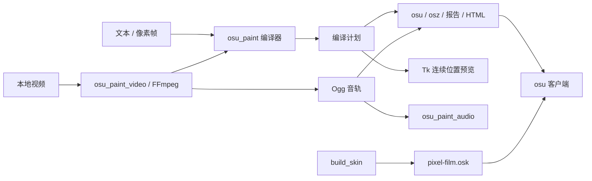

# osu-paint 架构

## 用途与范围

将 `#` / `.` 像素帧或本地视频编译为 osu!mania 音符与 BPM/SV 控制点，在指定时间窗口近似静止展示，再快速进出场。应用支持 1–18 列，桌面端与 CLI 共用生成逻辑。Pixel Film 是独立的 1–16K 皮肤，不改变谱面的键数或时间。

## 模块与依赖

| 模块 | 职责 | 边界 |
| --- | --- | --- |
| `osu_paint.py` | 解析文本、编译帧、积分位置、编码 `.osu`、导出与 CLI | 核心只用标准库；CLI 视频分支按需导入视频模块 |
| `osu_paint_video.py` | 参数解析、FFmpeg 抽帧与提取 Ogg、刷新窗口安排 | 调用核心编译器；使用 `imageio-ffmpeg` 定位 FFmpeg |
| `osu_paint_audio.py` | 桌面音乐播放、定位与设备生命周期 | 按需加载 pygame / mutagen；不参与谱面编译 |
| `osu_paint_desktop.py` | Tk 编辑、项目保存与打开、预览、异步导入与导出 | 调用以上模块；主线程管理控件与项目状态 |
| `osu-paint.pyw` | 无终端窗口的桌面入口 | 仅启动桌面端 |
| `tools/build_skin.py` | 生成皮肤配置、PNG 与 `.osk` | 独立标准库脚本；不打包到应用 |

## 数据流与时间模型

1. `parse_frames` 产生同尺寸的字符串行数组；`---` 分帧。编辑项目可含空白帧，普通图案导出要求每帧有亮格；视频允许黑场，但整段必须有音符。
2. `compile_frames` 验证均分 / 自由时间窗口、滚速、客户端与长条开关，生成帧窗口、`Point(time, beat_length, sv)` 和音符数组。
3. `Timeline` 对分段速度积分，并反求给定位置对应的时间；音符行中心位于判定线上方区域的 20%–80%。返回的计划包含参数、实际窗口、漂移、控制点和音符，是导出与预览的共同输入。
4. `encode_osu` 用列中心映射 `.osu` 的 0–512 横坐标。短音符为 type 1，长条为 type 128；红线后立即写对应绿线，防止红线重置继承速度。
5. `write_output` 写独立谱面、音频、报告和预览；`.osz` 只包含谱面与对应音频。刷新率 / 旧 FPS 排帧项目另写播放说明。

stable 按整数毫秒布置音符头尾，用分段 SV 拟合行中心；lazer 使用小数时间与自身参考 BPM / 滚速模型。两者不能共用一套舍入规则。长条从连续亮格的底部行起头、顶部行结束，不跨空格或不同画面。相邻相同画面可在漂移预算内共用音符。

视频按时间戳采样而非编码帧编号，支持可变帧率。刷新率排帧按实际频率与分频数直接推导各边界，避免逐帧累计舍入。stable 的整数时间预算可能降低行数；画面相位只调整画面，Ogg 保持共同开始偏移及源音画延迟。请求参数、实际参数与对齐元数据分别保存。

## 项目、线程与副作用

桌面 JSON v1 保存画布、逐帧时间、模式与设置；v2 增加视频元数据及 Base64 Ogg，可脱离原视频继续编辑与导出。缺少客户端字段时采用 lazer，缺少长条字段时采用 false。TXT 不保存音轨与设置；`report.json` 是编译报告，不是可打开的项目。

导入与选帧预览在后台执行，通过取消事件终止 FFmpeg，通过队列交回结果；Tk 主线程只在成功后替换项目。导出立即重新编译并抓取计划和音轨，后台写文件，编辑不会改变正在导出的快照。音乐预览跟随音频时钟，音轨结束后画面继续播放。

编译和参数解析尽量保持纯函数；文件写入集中于导出、项目保存和独立皮肤构建，媒体子进程集中于视频模块。更改相关参数或画布尺寸后，桌面端移除已失效的刷新对齐标记。

## 验证与兼容边界

`tests/` 覆盖纯编译、实际 `.osu` 重新解析积分、Node 执行 HTML 绘制、Tk 编辑与快照、合成媒体的真实 FFmpeg 解码、Ogg 播放及皮肤包资源。测试使用合成输入，不依赖个人视频或联网。

桌面与 HTML 预览只模拟连续几何位置，不模拟皮肤、判定、Miss 淡出或显示刷新。刷新窗口验证使用指定频率与相位，不代表实机已经锁相。当前皮肤修复与客户端差异见 [皮肤说明](skin.md)；时间策略证据见 [刷新约束](research/render-phase-constraints.md) 与 [stable 兼容记录](research/stable-compatibility.md)。

## 文件管理

Git 管理源码、文档、回归测试、示例、构建脚本和 `pixel-film.osk`。皮肤包是特意保留的交付文件，必须可从脚本复现。`.build-env/` 是本地构建环境；`build/` 与 `__pycache__/` 是可清理缓存；`dist/` 保存可直接运行的 EXE；`output/` 与根目录 `.osz` 是本地导出，不进入版本库。

历史研究记录中的 `build/`、`output/` 路径是当次诊断位置，清理缓存后可能不存在。保留研究结论与版本依据；缓存是否仍在不代表功能是否支持。清理范围由用户确认，项目 JSON 与音轨不能仅凭目录名称判为冗余。
